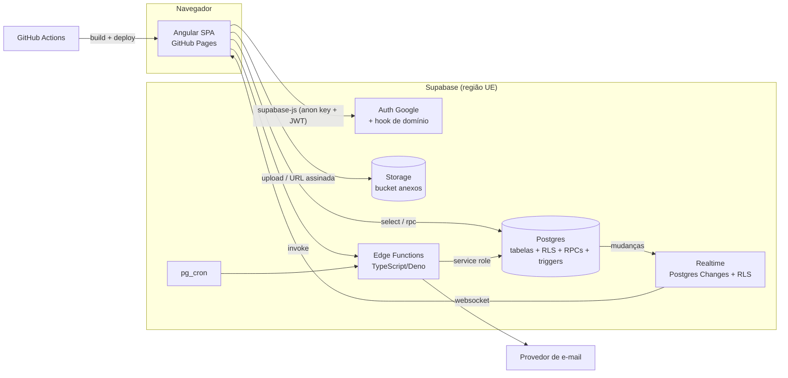
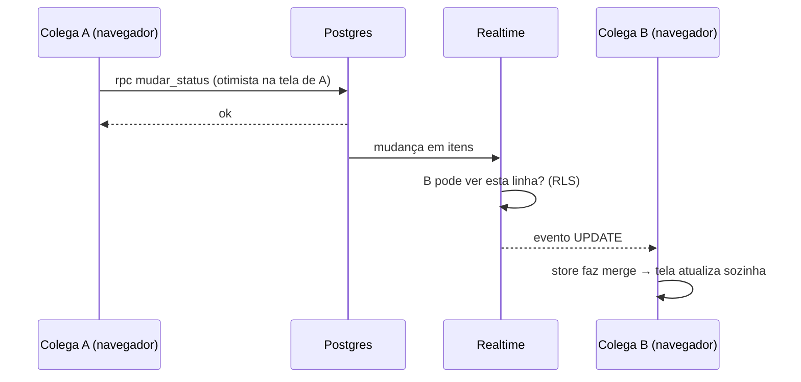

# Arquitetura



## Camadas
| Camada | Onde | Responsabilidade |
|---|---|---|
| Apresentação | `features/*/components`, `*.page.ts`, `shared/ui` | Telas, formulários, visões. Sem regras de permissão "reais". |
| Estado | `features/*/*.store.ts` (signals) | Cache em memória, atualização otimista e rollback, filtros da tela. |
| Acesso a dados | `features/*/*.service.ts`, `core/services` | Única camada que chama `supabase-js`. Converte snake_case ↔ camelCase. |
| Regras de negócio | Postgres: RPCs (`security definer`) + triggers + CHECKs | Status, solicitações, recorrência, exclusão, menções, histórico, fila de e-mails. |
| Permissões | Postgres: RLS + funções auxiliares | Quem vê e quem altera o quê. |
| Tarefas assíncronas | Edge Functions + pg_cron | E-mails, lembretes, limpeza do Storage, cadastro/desativação de usuários. |

## Estrutura do código Angular
```
src/
  environments/environment.ts            supabaseUrl, supabaseAnonKey, appUrl
  app/
    app.config.ts · app.routes.ts
    core/
      supabase.client.ts                 cria o client único
      auth/auth.service.ts               sessão, login Google, logout, perfil atual (signal)
      auth/acesso.store.ts               setores visíveis/administrados, papéis (signals)
      guards/autenticado.guard.ts · lider.guard.ts · admin.guard.ts
      models/                            tipos gerados (database.types.ts) + rotulos.ts
      services/toast.service.ts · tema.service.ts · realtime.service.ts · cache-local.service.ts
    shared/
      ui/  botao, pill-status, avatar, modal, confirmacao, editor-rico (TipTap), seletor-pessoa,
           campo-data, vazio, carregando, kpi-card, barra-progresso
      pipes/ data-curta.pipe, rotulo.pipe, html-seguro.pipe (DOMPurify)
      utils/ datas.ts (Europe/Lisbon), arvore.ts, recorrencia.ts
    layout/
      shell/shell.component.ts           barra lateral (menu muda por perfil), seletor de setor, tema, sair
    features/
      login/                             tela de login + "Acesso não autorizado"
      painel/                            US-28
      produtividade/                     US-29
      projetos/                          grade de projetos
      tarefas/                           US-21..27 — tarefas.page + views/{lista,kanban,arvore,agenda,mes,semana,gantt,pessoa,carga,deps}
      item/                              página do item — item.page + components/{cabecalho,status,campos,filhos,checklist,deps,
                                         solicitacoes-do-item,comentarios,anexos,historico}
      solicitacoes/                      US-15..17
      equipe/                            US-06 organograma + linha de decisão
      usuarios/                          US-03, US-04 (admin)
      setores/                           US-05 (admin)
supabase/
  config.toml
  migrations/                            0001_tipos.sql, 0002_tabelas.sql, ... (uma por tarefa de banco)
  functions/
    enviar-notificacoes/  limpar-anexos/
    _shared/  (cliente admin, templates de e-mail, cors)
  tests/                                 *.test.sql (pgTAP)
  seed.sql
scripts/importar-v26.ts                   US-33
e2e/fluxo-principal.spec.ts
```

## Como os dados fluem (exemplo: abrir solicitação)
0. (Os colegas envolvidos recebem a mudança por tempo real — ver §Tempo real.)
1. `item.page` → `SolicitacoesStore.abrir(dados)` adiciona a solicitação e muda o status do item **na tela** (otimista).
2. `SolicitacoesService.abrir()` → `supabase.rpc('abrir_solicitacao', {...})`.
3. O RPC valida `pode_ver_item`, insere a solicitação, muda o status do item, grava histórico e insere em `notificacoes`, tudo numa transação.
4. Sucesso: a store troca os dados otimistas pela resposta (item + solicitação). Erro: desfaz e mostra toast.
5. pg_cron chama `enviar-notificacoes` → e-mail ao destinatário.

## Carregamento de dados — objetivo: "instantâneo"
Três técnicas juntas, para nunca precisar de recarregar a página:
1. **Primeira pintura imediata (cache local):** ao sair de cada tela, a store guarda um retrato dos dados em IndexedDB (`cache-local.service.ts`, chave por perfil). Ao abrir o app, a tela aparece na hora com esse retrato e, em paralelo, busca a versão nova no servidor. O cache é apagado no logout.
2. **Ação instantânea (otimista):** toda ação muda a tela antes da resposta do servidor; se falhar, desfaz com toast (FLUXOS.md §7). 1 RPC por ação.
3. **Atualização automática (tempo real):** mudanças feitas por colegas chegam via Supabase Realtime e aparecem sozinhas em todas as telas abertas (lista, Kanban, item, solicitações, contadores do menu).

Outros pontos:
- Ao entrar: 1 chamada `rpc('carregar_inicial')` devolve perfil, vínculos, setores e pessoas ativas.
- Tarefas: `vw_itens` (a RLS já limita ao que a pessoa vê); paginada acima de 500 itens.
- Comentários, anexos, histórico: carregados ao abrir o item e mantidos atualizados pelo tempo real enquanto o item está aberto.
- Trocar de tela não recarrega o que já existe na store.

## Tempo real

- `RealtimeService` abre **um** canal ao fazer login e fecha no logout; distribui eventos às stores (`ItensStore`, `SolicitacoesStore`, `ComentariosStore`...).
- Merge por `id`; evento mais antigo que o dado da store (comparando `atualizado_em`) é ignorado — evita "piscar" depois da própria ação otimista.
- Indicador discreto no rodapé da barra lateral: ● Ao vivo / ○ Reconectando…; ao reconectar, a store busca `atualizado_em > último conhecido`.
- Aba do navegador em segundo plano: mantém o canal; se ficar > 10 min sem ligação, faz recarga silenciosa dos dados ao voltar.

## Rotas
| rota | tela | guard |
|---|---|---|
| `/login` | login | — |
| `/sem-acesso` | acesso não autorizado | — |
| `/painel` | Painel | lider |
| `/produtividade` | Produtividade | lider |
| `/projetos` | Projetos | autenticado |
| `/tarefas?vista=kanban&setor=...` | Tarefas / Minhas tarefas | autenticado |
| `/item/:id` | página do item | autenticado |
| `/solicitacoes?aba=recebidas&id=...` | Solicitações | autenticado |
| `/equipe` | Equipe | autenticado |
| `/usuarios` | Usuários | admin |
| `/setores` | Setores | admin |
Rota inicial: `/painel` se líder/adm, senão `/tarefas`.

## Decisões técnicas principais
Ver DECISOES.md. Destaques: sem servidor Node; regras no banco via RPC; GitHub Pages com `404.html` para rotas do SPA; TipTap como editor rico; DOMPurify para sanitização; CDK drag-drop no Kanban; Gantt e calendários feitos à mão (sem biblioteca pesada).
