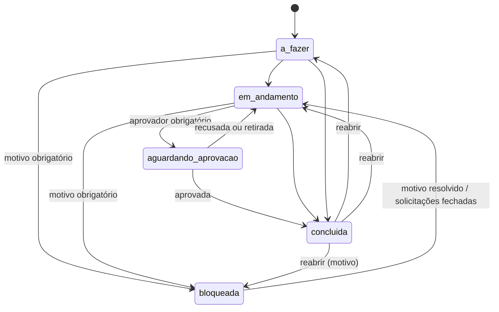
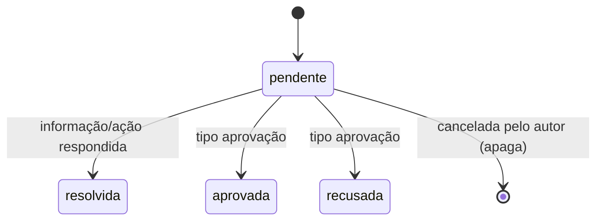
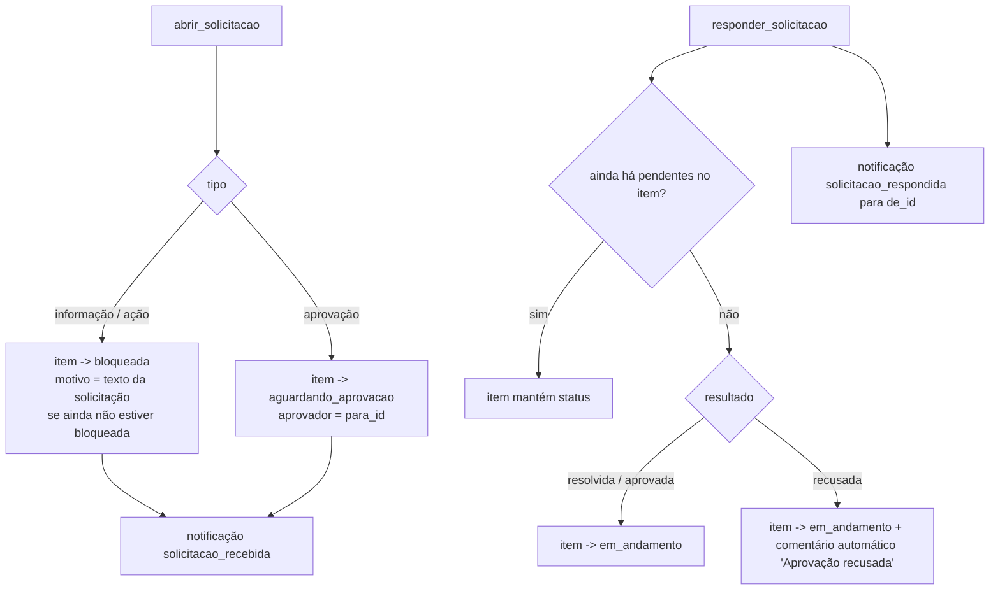
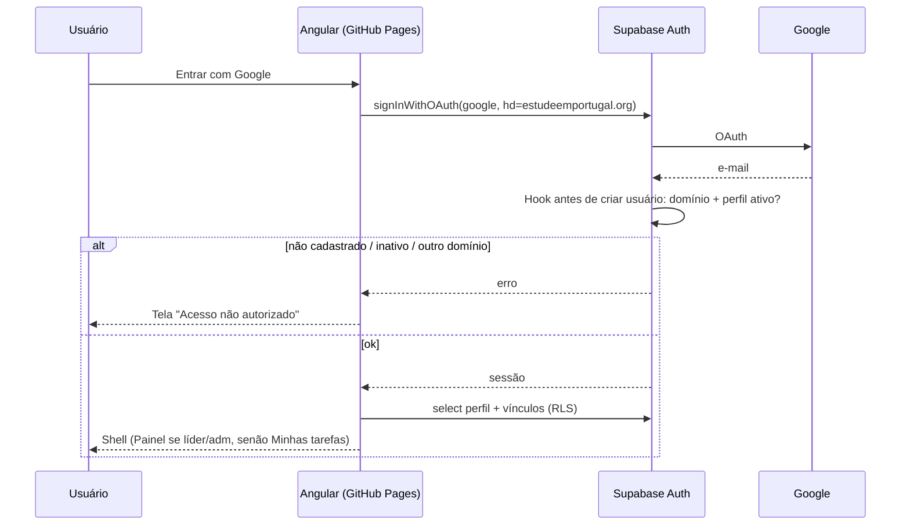
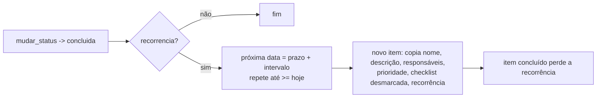
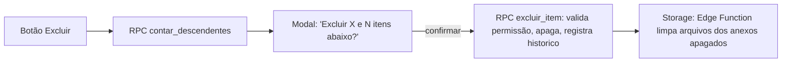
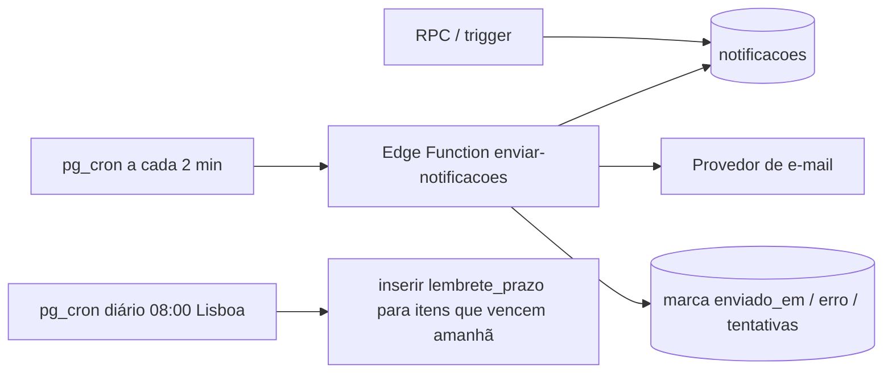
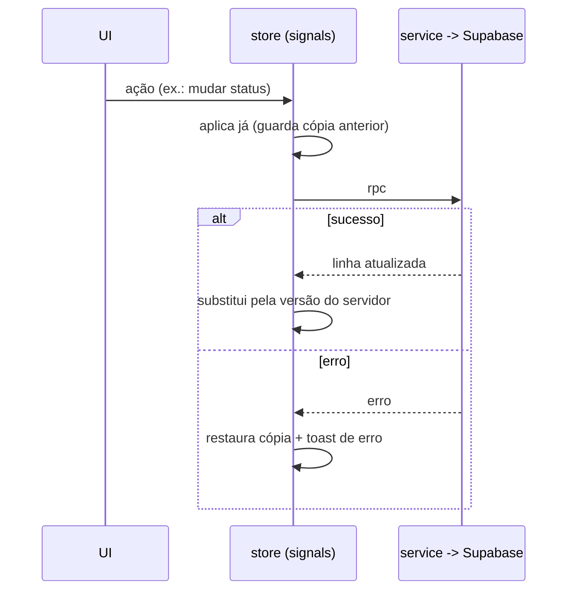
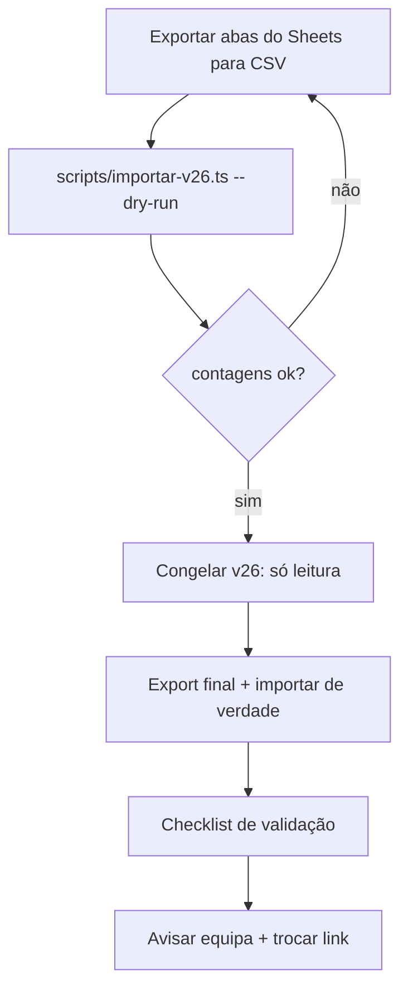

# Fluxos e máquinas de estado

## 1. Status do item

Regras (RPC `mudar_status`):
- Entrar em `bloqueada` exige `motivo_bloqueio_html` não vazio; entrar em `aguardando_aprovacao` exige `aprovador_id`.
- Entrar em `bloqueada`/`aguardando_aprovacao` grava `parado_desde = now()`; sair limpa e soma os dias em `historico` (usado por "tempo parado").
- `concluida` grava `concluido_em`; reabrir limpa `concluido_em` (bug corrigido no v26: reabrir para qualquer status deve funcionar).
- Concluir item com `recorrencia` cria a próxima ocorrência (ver §4).
> ⚠️ A CONFIRMAR: concluir uma tarefa com subtarefas abertas é permitido (v26 permite)? O kit assume **permitido com aviso**.

## 2. Solicitações

Efeito no item (dentro dos RPCs, numa transação):

> ⚠️ A CONFIRMAR: aprovação aprovada deve levar o item a **Concluída** ou a **Em andamento**? O v26 volta a Em andamento; o kit mantém isso.

## 3. Login

## 4. Recorrência

Intervalos: diaria +1d · semanal +7d · quinzenal +14d · mensal +1 mês · anual +1 ano. `inicio` desloca pela mesma diferença.
> ⚠️ A CONFIRMAR: o protótipo trata "Diária" como **dias úteis** (pula sábado e domingo) e, no mensal, mantém o dia do mês até o último dia válido. Implementado como está acima (+1 dia corrido); se for dias úteis, ajustar `privado.proxima_data` numa nova migration.

## 5. Exclusão em cascata

## 6. Notificações

## 7. Atualização otimista no frontend

## 8. Virada v26 → v2

