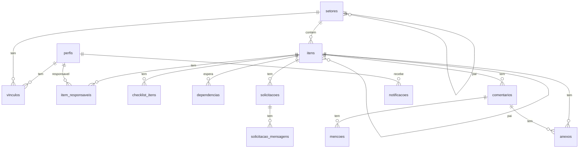

# Schema da base de dados (Supabase / Postgres)

Schema `public`. Todas as tabelas têm **RLS ativado** (políticas em SEGURANCA.md). Chaves `uuid` com `gen_random_uuid()`. Datas de evento em `timestamptz`; prazos em `date`.
A coluna `legacy_id` guarda o ID do Nexus v26 para a importação ser idempotente (US-33).

## Tipos (enums)
```sql
create type papel_setor        as enum ('lider','membro');
create type status_item        as enum ('a_fazer','em_andamento','bloqueada','aguardando_aprovacao','concluida');
create type prioridade         as enum ('alta','media','baixa');
create type recorrencia        as enum ('diaria','semanal','quinzenal','mensal','anual');
create type tipo_solicitacao   as enum ('informacao','acao','aprovacao');
create type status_solicitacao as enum ('pendente','resolvida','aprovada','recusada');
create type tipo_notificacao   as enum ('boas_vindas','atribuicao','mencao','comentario','solicitacao_recebida','solicitacao_respondida','lembrete_prazo');
```
Rótulos em PT-BR para a interface ficam em `src/app/core/models/rotulos.ts` (ex.: `aguardando_aprovacao` → "Aguardando aprovação").

## Tabelas

### perfis
Pessoa do sistema. Criada pelo Adm **antes** do primeiro login; ligada ao `auth.users` no primeiro login pelo e-mail.
| coluna | tipo | obrig. | padrão | notas |
|---|---|---|---|---|
| id | uuid | sim | gen_random_uuid() | PK |
| auth_id | uuid | não | | UNIQUE, FK → auth.users(id) on delete set null |
| email | citext | sim | | UNIQUE, termina em `@estudeemportugal.org` (CHECK) |
| nome | text | sim | | |
| iniciais | text | sim | | 2–3 letras, gerado pelo app |
| is_admin | boolean | sim | false | adm do sistema |
| ativo | boolean | sim | true | |
| criado_em | timestamptz | sim | now() | |
| desativado_em | timestamptz | não | | |
| legacy_id | text | não | | UNIQUE |

### setores
| coluna | tipo | obrig. | padrão | notas |
|---|---|---|---|---|
| id | uuid | sim | gen_random_uuid() | PK |
| nome | text | sim | | |
| pai_id | uuid | não | | FK → setores(id) on delete restrict; CHECK pai_id <> id; trigger impede ciclos |
| ativo | boolean | sim | true | |
| criado_por | uuid | sim | | FK → perfis(id) |
| criado_em | timestamptz | sim | now() | |
| legacy_id | text | não | | UNIQUE |

### vinculos
| coluna | tipo | obrig. | notas |
|---|---|---|---|
| perfil_id | uuid | sim | FK → perfis(id) on delete cascade |
| setor_id | uuid | sim | FK → setores(id) on delete cascade |
| papel | papel_setor | sim | |
| criado_em | timestamptz | sim | default now() |
PK (perfil_id, setor_id).

### itens
Projeto (nivel 0), Tarefa (1) e Subtarefa (2) na mesma tabela.
**Tarefa avulsa:** tarefa (nivel 1) sem projeto — `pai_id` nulo, `setor_id` escolhido na criação. Pode ter subtarefas normalmente. Na interface aparece como "Sem projeto".
| coluna | tipo | obrig. | padrão | notas |
|---|---|---|---|---|
| id | uuid | sim | gen_random_uuid() | PK |
| setor_id | uuid | sim | | FK → setores(id). Filhos herdam o setor do pai (trigger); sem pai, vem do formulário |
| pai_id | uuid | não | | FK → itens(id) on delete cascade. CHECK: nivel 0 → nulo; nivel 1 → nulo (avulsa) ou um projeto; nivel 2 → obrigatório (uma tarefa) |
| nivel | smallint | sim | | CHECK 0..2; trigger: com pai, nivel = nivel do pai + 1 |
| nome | text | sim | | CHECK length 1..200; **editável** por quem pode editar o item |
| descricao_html | text | não | '' | sanitizado |
| status | status_item | sim | 'a_fazer' | |
| prioridade | prioridade | sim | 'media' | |
| inicio | date | não | | |
| prazo | date | não | | CHECK prazo >= inicio |
| motivo_bloqueio_html | text | não | | obrigatório se status = bloqueada (CHECK) |
| aprovador_id | uuid | não | | obrigatório se status = aguardando_aprovacao (CHECK) |
| parado_desde | timestamptz | não | | preenchido ao entrar em bloqueada/aguardando; limpo ao sair |
| recorrencia | recorrencia | não | | só nivel > 0 |
| ordem | integer | sim | 0 | ordenação manual |
| concluido_em | timestamptz | não | | preenchido ao concluir |
| criado_por | uuid | sim | | FK → perfis(id) |
| criado_em | timestamptz | sim | now() | |
| atualizado_em | timestamptz | sim | now() | trigger |
| legacy_id | text | não | | UNIQUE |

### item_responsaveis
Um item (projeto, tarefa ou subtarefa) pode ter **vários responsáveis** (zero ou mais).
| coluna | tipo | obrig. | notas |
|---|---|---|---|
| item_id | uuid | sim | FK → itens(id) on delete cascade |
| perfil_id | uuid | sim | FK → perfis(id) |
| atribuido_por | uuid | sim | FK → perfis(id) |
| criado_em | timestamptz | sim | default now() |
PK (item_id, perfil_id). Alterada só pelo RPC `definir_responsaveis` (gera notificação `atribuicao` para quem entrou).

### checklist_itens
| coluna | tipo | obrig. | notas |
|---|---|---|---|
| id | uuid | sim | PK |
| item_id | uuid | sim | FK → itens(id) on delete cascade |
| texto | text | sim | | texto do passo; pode ter menções `<span class="mention" data-uid>` (T-47) |
| feito | boolean | sim | default false |
| ordem | integer | sim | default 0 |

### dependencias
| coluna | tipo | obrig. | notas |
|---|---|---|---|
| item_id | uuid | sim | FK → itens(id) on delete cascade — o que espera |
| depende_de_id | uuid | sim | FK → itens(id) on delete cascade — o que precisa terminar antes |
PK (item_id, depende_de_id); CHECK item_id <> depende_de_id; trigger impede ciclos.

### solicitacoes
| coluna | tipo | obrig. | padrão | notas |
|---|---|---|---|---|
| id | uuid | sim | gen_random_uuid() | PK |
| item_id | uuid | sim | | FK → itens(id) on delete cascade |
| de_id | uuid | sim | | FK → perfis(id) |
| para_id | uuid | sim | | FK → perfis(id); CHECK de_id <> para_id |
| tipo | tipo_solicitacao | sim | | |
| texto_html | text | sim | | |
| status | status_solicitacao | sim | 'pendente' | aprovada/recusada só se tipo = aprovacao; resolvida só se tipo <> aprovacao (CHECK) |
| criado_em | timestamptz | sim | now() | |
| respondido_em | timestamptz | não | | |
| editado_em | timestamptz | não | | preenchido por `editar_solicitacao` |
| legacy_id | text | não | | UNIQUE |

### solicitacao_mensagens
| coluna | tipo | obrig. | notas |
|---|---|---|---|
| id | uuid | sim | PK |
| solicitacao_id | uuid | sim | FK → solicitacoes(id) on delete cascade |
| autor_id | uuid | sim | FK → perfis(id) |
| texto_html | text | sim | |
| criado_em | timestamptz | sim | default now() |
| editado_em | timestamptz | não | carimbado por trigger ao editar (só o autor edita/apaga) |

### comentarios
| coluna | tipo | obrig. | notas |
|---|---|---|---|
| id | uuid | sim | PK |
| item_id | uuid | sim | FK → itens(id) on delete cascade |
| autor_id | uuid | sim | FK → perfis(id) |
| texto_html | text | sim | |
| criado_em | timestamptz | sim | default now() |
| editado_em | timestamptz | não | |
| legacy_id | text | não | UNIQUE |

### mencoes
| coluna | tipo | obrig. | notas |
|---|---|---|---|
| comentario_id | uuid | sim | FK → comentarios(id) on delete cascade |
| perfil_id | uuid | sim | FK → perfis(id) |
PK (comentario_id, perfil_id). Preenchida pelo RPC `salvar_comentario` a partir dos `data-uid` do HTML.

### checklist_mencoes
| coluna | tipo | obrig. | notas |
|---|---|---|---|
| checklist_id | uuid | sim | FK → checklist_itens(id) on delete cascade |
| perfil_id | uuid | sim | FK → perfis(id) |
PK (checklist_id, perfil_id). Só leitura para o app: o trigger `checklist_itens_mencoes` preenche a partir dos `data-uid` do texto do passo e avisa (`mencao`) quem foi marcado (T-47).

### anexos
| coluna | tipo | obrig. | notas |
|---|---|---|---|
| id | uuid | sim | PK |
| item_id | uuid | sim | FK → itens(id) on delete cascade |
| comentario_id | uuid | não | FK → comentarios(id) on delete cascade |
| nome | text | sim | nome original |
| caminho | text | não | caminho no bucket `anexos`: `{setor_id}/{item_id}/{uuid}-{nome}` |
| link_externo | text | não | https:// — CHECK (caminho is not null) <> (link_externo is not null) |
| tamanho_bytes | bigint | não | CHECK <= 20971520 |
| mime | text | não | |
| enviado_por | uuid | sim | FK → perfis(id) |
| criado_em | timestamptz | sim | default now() |

### historico
Preenchida **só por triggers** (auditoria simples de `itens`, `solicitacoes`, `vinculos`, `perfis`; e, desde a T-35, troca de responsável como `tabela='itens'`, `campo='responsaveis'`).
| coluna | tipo | notas |
|---|---|---|
| id | bigint identity | PK |
| tabela | text | |
| registro_id | uuid | |
| perfil_id | uuid | quem fez (meu_perfil_id()) |
| acao | text | insert / update / delete |
| campo | text | null em insert/delete |
| valor_antes | text | |
| valor_depois | text | |
| criado_em | timestamptz | default now() |

### notificacoes
Fila de e-mails. Inserida por triggers/RPCs; consumida pela Edge Function `enviar-notificacoes`.
| coluna | tipo | notas |
|---|---|---|
| id | uuid | PK |
| tipo | tipo_notificacao | |
| destinatario_id | uuid | FK → perfis(id) |
| item_id | uuid | null permitido |
| dados | jsonb | assunto, trecho, link |
| criado_em | timestamptz | default now() |
| enviado_em | timestamptz | null = pendente |
| tentativas | smallint | default 0 |
| erro | text | |
Regra: não notificar a própria pessoa que fez a ação.

## Funções de acesso
Ficam no schema `privado` (fora da API): `meu_perfil_id`, `eh_admin`, `setores_descendentes`, `setores_visiveis`, `setores_administrados`, `administra_setor`, e as próximas (`itens_envolvidos`, `pode_ver_item`, `pode_editar_item`). Trigger `setores_impede_ciclo`. Ver SEGURANCA.md §2.

## Views
- `vw_itens` — itens + `responsaveis` (uuid[]), `projeto_id` (raiz, ou nulo se avulsa), `meu_envolvimento` (texto[]: responsavel, criador, aprovador, solicitacao, mencao, contexto), `atrasado` (prazo < hoje e status <> concluida), `dias_parado`, `qtd_filhos`, `qtd_comentarios`, `qtd_anexos`, `solicitacoes_pendentes`. `security_invoker = true` (respeita RLS).
- `vw_produtividade` — uma linha por (item concluído × responsável), com `inicio`, `prazo`, `concluido_em`, `dias_ciclo`, `no_prazo`, `dias_parado_total`. `security_invoker = true`.

## Índices
- `itens (setor_id, status)`, `itens (pai_id)`, `itens (criado_por)`, `itens (aprovador_id)`, `itens (prazo) where status <> 'concluida'`
- `item_responsaveis (perfil_id, item_id)` — base da visão "só o que me envolve"
- `vinculos (setor_id)`, `setores (pai_id)`
- `solicitacoes (para_id) where status = 'pendente'`, `solicitacoes (item_id)`, `solicitacoes (de_id)`
- `comentarios (item_id, criado_em)`, `anexos (item_id)`, `historico (tabela, registro_id, criado_em)`
- `notificacoes (criado_em) where enviado_em is null`

## Storage
Bucket privado `anexos`, limite 20 MB, sem tipos executáveis. Primeiro segmento do caminho = `setor_id` (usado pelas políticas). Download por URL assinada (60 s) criada no navegador; imagens coladas em comentários/descrições guardam `` e recebem URL assinada ao exibir. Arquivos órfãos após excluir item: Edge Function `limpar-anexos`.

## Tempo real
Tabelas na publicação `supabase_realtime` (com `replica identity full` para o update trazer a linha inteira):
`itens`, `item_responsaveis`, `checklist_itens`, `dependencias`, `solicitacoes`, `solicitacao_mensagens`, `comentarios`, `anexos`.
O Realtime aplica a RLS: cada pessoa só recebe eventos de linhas que pode ver. Ver ARQUITETURA.md §Tempo real.

## Diagrama

